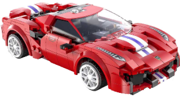

# CaDA Race Car

CaDA Race Car ist ein per Bluetooth LE gesteuertes RC-Auto. Die App steuert es über Bluetooth-LE-Werbenachrichten; eine herkömmliche Verbindung wird nicht hergestellt.

## Kanäle

Das Gerät stellt vier Kanäle bereit:

| Kanäle | Zweck | Ausgabe |
|---|---|---|
| 1 | Gas | -100 % bis +100 % |
| 2 | Lenkung | -100 % bis +100 % |
| 3 | Frontscheinwerfer | Aus / Ein |
| 4 | Rücklichter | Aus / Ein |

Die Lichtkanäle schalten sich ein, wenn die Ausgabe in eine der beiden Richtungen 50 % überschreitet.

## Erste Schritte

1. Schalte das Auto ein.
2. Öffne die Geräteliste und tippe auf **Nach neuen Geräten suchen**. Gefundene Geräte werden zur Liste hinzugefügt.
3. Verwende das Gerät in einem Modell und weise seine Kanäle Controller-Aktionen zu.

## Siehe auch

- [Geräte](../../pages/device-list/README.md)
- [Controller-Aktion](../../pages/controller-action/README.md)
