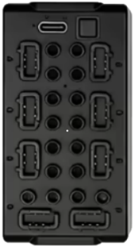

# JIESTAR – SCM 8

**JIESTAR – SCM 8** ist ein Bluetooth-Low-Energy-Modul (BLE), das bis zu acht Motoren ansteuert. Es können bis zu drei Module gleichzeitig gesteuert werden.

## Kanäle

Jedes **JIESTAR – SCM 8**-Modul stellt acht Kanäle bereit:

| Kanäle | Zweck | Ausgabe |
|---|---|---|
| 1–8 | Anschlüsse A, B, C, D, E, F, G, H | -100 % bis +100 % |

## Erste Schritte

⚠️ **Das Modul wird bei der Suche nicht gefunden!** ⚠️

1. Öffne die Geräteliste, um das Gerät manuell hinzuzufügen.
2. Aktiviere in der Liste zum manuellen Hinzufügen **JIESTAR – SCM 8, Gerät 1**. Verwende für weitere Module **Gerät 2** und **Gerät 3**.
3. Schalte das **JIESTAR – SCM 8**-Modul ein. Nach dem Einschalten ist **Gerät 1** die Standardinstanz; die LED blinkt einmal pro Zyklus. Ändere die Instanz durch kurzes Drücken der Modultaste. Für **Gerät 2** blinkt die LED zweimal pro Zyklus, für **Gerät 3** dreimal.
4. Verwende das Gerät in einem Modell und weise seine Kanäle Controller-Aktionen zu.

## Hinweise

- Es werden bis zu drei **JIESTAR – SCM 8**-Module unterstützt.
- Die Ausgabe wird als Bluetooth-Werbenachricht gesendet. Daher meldet das Modul weder einen Verbindungsstatus noch die Akkuspannung.
- Die Verbindungsnachricht wird erneut gesendet, wenn alle Kanäle einige Sekunden lang auf null stehen.

## Siehe auch

- [Geräte](../../pages/device-list/README.md)
- [Controller-Aktion](../../pages/controller-action/README.md)
