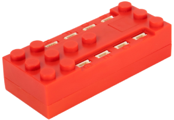

# SBrick Light

SBrick Light ist ein Bluetooth-LE-Controller für LED-Leuchten mit bis zu acht Lichtanschlüssen.

## Kanäle

Das Gerät besitzt acht Anschlüsse (A–H), jeweils mit einer RGB-Leuchte. Du kannst jeden Anschluss auf eine von zwei Arten steuern:

- **RGB**: Lege in den Einstellungen die RGB-Farbe des Anschlusses fest. Der Kanal steuert dann dessen Helligkeit (acht Kanäle, einer pro Anschluss).
- **Mikrokanäle**: Steuere die roten, grünen und blauen Farbanteile getrennt (drei Mikrokanäle pro Anschluss, insgesamt 24).

| Modus | Kanäle | Zweck | Ausgabe |
|---|---|---|---|
| RGB | 1–8 (einer pro Anschluss A–H) | Helligkeit der für den Anschluss festgelegten Farbe | 0 % bis 100 % |
| Mikrokanäle | 24 (R, G, B für jeden Anschluss) | Helligkeit jeder einzelnen Farbkomponente | 0 % bis 100 % |

## Erste Schritte

1. Schalte den SBrick Light ein.
2. Öffne die Geräteliste und tippe auf **Nach neuen Geräten suchen**. Gefundene Geräte werden zur Liste hinzugefügt.
3. Verwende das Gerät in einem Modell und weise seine Kanäle Controller-Aktionen zu.

## Einstellungen

Wähle in den Geräteeinstellungen unter **Kanalfarben** für jeden Anschluss (A–H) eine Farbe aus. Im RGB-Modus wird diese Farbe verwendet; standardmäßig ist Weiß ausgewählt.

## Siehe auch

- [Geräte](../../pages/device-list/README.md)
- [Controller-Aktion](../../pages/controller-action/README.md)
