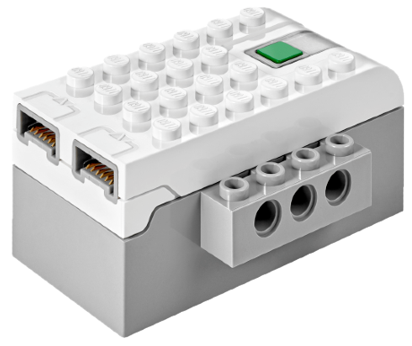

# LEGO WeDo 2.0 Smart Hub

Der LEGO WeDo 2.0 Smart Hub ist ein Bluetooth-LE-Hub mit zwei Anschlüssen für Motoren.

## Kanäle

Das Gerät stellt zwei Kanäle bereit:

| Kanäle | Zweck | Ausgabe |
|---|---|---|
| 1–2 | Anschlüsse A, B | -100 % bis +100 % |

## Erste Schritte

1. Schalte den Hub ein, indem du seine Taste drückst.
2. Öffne die Geräteliste und tippe auf **Nach neuen Geräten suchen**. Gefundene Geräte werden zur Liste hinzugefügt.
3. Verwende das Gerät in einem Modell und weise seine Kanäle Controller-Aktionen zu.

## Siehe auch

- [Geräte](../../pages/device-list/README.md)
- [Controller-Aktion](../../pages/controller-action/README.md)
