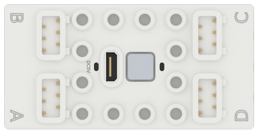

# Mould King - MKH 4.0

**Mould King - MKH 4.0** is a Bluetooth LE (BLE) module that drives up to four motors.

## Channels

The device exposes 4 channels:

| Channels | Purpose | Output |
|---|---|---|
| 1 - 4 | Ports A, B, C, D | -100 % to +100 % |

## Getting started

1. Power on the **Mould King - MKH 4.0** module by pressing its button.
2. Open the device list and press  **Scan for new devices**. Found devices are added to the list.
3. Use the device in a creation: assign its channels to controller actions.

## Detection

The module is found by its Bluetooth name (starting with `YX-01` or `YX-05`) or by its service, so it is also detected on platforms that do not report the service of an advertisement.

## Connection

- While connected, the module is queried about once per second to keep the session alive.
- When the connection is closed, all motors are stopped and the module is told that the session ends.

## Servo channels

A channel can be used as a normal motor or, with an encoder motor, as a servo (position control). Position moves (connecting, calibration, servo targets) use the speed from the device settings, by default 62.5 % of the maximum speed.

## Device settings

Open the settings of the device in the device list (swipe the device to the left, then press **Settings**). Without any change, the module behaves as described above.

| Setting | Default | Meaning |
|---|---|---|
| Stall protection | on | Sent to the module after connecting and when changed. |
| Position move speed (%) | 62.5 % | Speed of position moves, 1 % to 100 %. The slider works in steps of 1 %, so the default is shown rounded. |
| Set motor strength | off | While off, no motor strength is sent and the module keeps what it has. |
| Motor strength (%) | 100 % | Sent after connecting and when changed, only if *Set motor strength* is on. |
| Motor type (per port A - D) | XL | XL = 1650 units per degree (594000 per turn), L = about 1097 units per degree (395000 per turn), M = about 1097 units per degree (395000 per turn). The values of each type are independent. Used for servo angles and the limit percentages. |
| Limit positions (per port A - D) | off | Enables the position limits of the port. |
| Positive limit / Negative limit (% of one turn) | 17 % each | Limits of the port as percent of one revolution of the motor shaft (1 % is 3.6 degrees). Used only if *Limit positions* is on. |

Notes:

- Motor strength and limits are stored in the module. Switching the options off does not restore the previous state; power cycle the module for that.
- Changes are sent to a connected module immediately, otherwise with the next connection.
- Limits cannot be entered as raw encoder values, only as percent of one turn.
- The limit feature is experimental. Enabling the limits of a port also changes the leading digit of that port in the speed message to `1` (otherwise `0`). The effect of this digit has not been verified on hardware.

## Notes

- Messages longer than 20 characters are split into several writes; the module reassembles them.

## See also

- [Devices](../../pages/device-list/README.md)
- [Controller action](../../pages/controller-action/README.md)
